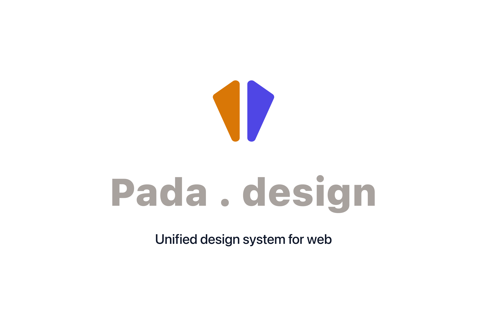

# Pada Design System



This is a React design system built with Vite. It includes a set of reusable components and a demo application to showcase them.

[Visit Pada.design to learn more](https://supreeth-kashyap.notion.site/Pada-Design-System-2c6a6474ca5a80cea166ed78587299a2)

## Figma design file

Avail the Figma file of the design system in the community for free

[Figma file](https://www.figma.com/community/file/1619638623779328209)


## Installation

To install the design system, run:

```bash
npm install pada-ds
```

Upgrading from 1.x? See the [2.0 migration guide](./docs/migration-2.0.md). The plan and progress for 2.0 are in [`docs/roadmap`](./docs/roadmap/README.md).

## Usage

```tsx
import 'pada-ds/tokens.css';
import 'pada-ds/styles.css';
import { Button } from 'pada-ds';
```

`pada-ds/tokens.css` only defines CSS custom properties. To also use Pada's document base styles (`body` background, color and font, and zero `p` margins), import the optional `pada-ds/base.css`:

```tsx
import 'pada-ds/base.css';
```

## Headless parts

`pada-ds/headless` ships the behaviour behind the components (state, keyboard handling, focus management, ARIA wiring and positioning) with no styles at all. Use it when you have your own visual language; every part exposes its state as `data-state`, `data-side`, `data-highlighted`, `data-disabled` and `aria-*` attributes for you to style.

```tsx
import { Dialog } from 'pada-ds/headless';

<Dialog.Root>
  <Dialog.Trigger className="my-button">Edit profile</Dialog.Trigger>
  <Dialog.Portal>
    <Dialog.Overlay className="my-overlay" />
    <Dialog.Content className="my-dialog">
      <Dialog.Title>Edit profile</Dialog.Title>
      <Dialog.Description>Changes save automatically.</Dialog.Description>
      <Dialog.Close>Done</Dialog.Close>
    </Dialog.Content>
  </Dialog.Portal>
</Dialog.Root>
```

```css
.my-dialog[data-state="open"] { animation: fade-in var(--pada-duration-slow) var(--pada-ease-emphasized); }
```

Available parts: `Dialog` (plus `useDialog()` for custom parts), `Popover`, `Tooltip` (with `Tooltip.Provider` for shared delays), `DropdownMenu` (items, checkbox and radio items, groups, labels, separators, submenus), `Tabs`, `Accordion`, `Collapsible`, `Field`, `Toggle` / `ToggleGroup`, `Combobox` (single or multiple, with a pluggable filter), `NumberInput`, `Calendar`, `Tree`, `HoverCard`, `ContextMenu`, `Menubar`, `Slider` (any number of thumbs), `PinInput` and `Resizable` (window splitter). Each follows the matching WAI-ARIA Authoring Practices pattern. Any part that renders an element accepts `asChild`, which merges its behaviour onto your own element (a router link, a custom button) instead of rendering a new one.

Portalled parts render into `document.body`, or into the element provided by `PortalContainerContext` (`ThemeProvider` provides one, so overlays keep a subtree's theme).

The building blocks are exported too: `Slot`, `Portal`, `VisuallyHidden`, `useControllableState`, `usePresence` (keeps an element mounted until its exit transition ends), `useDismissable` (Escape and outside clicks, layered), `useFocusScope`, `useScrollLock`, `useHideOthers`, `useFloatingPosition`, `useTypeahead` and list navigation helpers.

## Theming

By default the theme follows the operating system (`prefers-color-scheme`). To force a theme, set `data-theme="light"` or `data-theme="dark"` on `<html>` or on any container. Only that subtree is themed, so one section of a page can use a different theme:

```html
<html data-theme="dark">
  ...
  <section data-theme="light">Always light</section>
</html>
```

```ts
document.documentElement.dataset.theme = 'dark'; // or 'light'
delete document.documentElement.dataset.theme; // follow the OS again
```

### Theme axes

Every axis is an attribute that works on `<html>` or any container, and they combine freely:

| Attribute | Values | Effect |
|---|---|---|
| `data-theme` | `light`, `dark` (none = follow the OS) | Light or dark colours |
| `data-accent` | any palette hue (`indigo` default, `violet`, `amber`, `emerald`, `rose`, `sky`, …) or `custom` | Accent colour, hovers, focus rings |
| `data-neutral` | `stone` (default), `slate`, `gray`, `zinc`, `neutral` | Surfaces, text and borders |
| `data-density` | `compact`, `comfortable`, `spacious` | Spacing and control heights |
| `data-radius` | `none`, `sm`, `md`, `lg`, `xl` | Corner radius scale |
| `data-motion` | `reduced`, `full` | Overrides the OS reduced-motion setting |
| `data-contrast` | `standard`, `more` | Stronger muted text and borders (also follows `prefers-contrast: more`) |

```html
<html data-theme="dark" data-accent="amber" data-density="compact">
```

### Knobs

Derived tokens are computed from a handful of knobs, so one change re-themes every component. Set them on `:root`, or on an element that also carries a theme attribute (`data-accent`, `data-theme`, …): derived tokens are computed on those elements, so a knob set anywhere else does not reach them. With `ThemeProvider`, pass `accentHue` instead of setting `--pada-accent-hue` yourself.

```css
.brand[data-accent] {
  --pada-accent-hue: 160;   /* used by data-accent="custom" (OKLCH hue) */
  --pada-radius-base: 0.5rem;
  --pada-density: 0.9;
  --pada-type-base: 14px;
  --pada-type-ratio: 1.25;
}
```

Tokens use the `--pada-` prefix: `--pada-color-fg-muted`, `--pada-color-accent-solid`, `--pada-space-4`, `--pada-radius-md`, `--pada-duration-normal`, `--pada-z-modal` and so on. The full list ships as `pada-ds/tokens.json`, `pada-ds/tokens.scss` (with breakpoint mixins) and `pada-ds/tokens` (JS: `import { tokens, breakpoints } from 'pada-ds/tokens'`).

Pada 1.x token names (`--color-primary-600`, `--spacing-4`, …) still work as aliases and will be removed in 3.0.

The tokens use `light-dark()`, `color-mix()`, relative colour syntax and `pow()`, so they need a 2024-era browser (Chrome 123, Safari 18, Firefox 128 or later).

## For AI coding agents

The package ships a machine-readable API description, generated from the TypeScript source by `npm run build:manifest` (part of `npm run build`):

- `pada-ds/manifest.json`: every exported component with its import path and props (name, type, required, default, JSDoc description).
- `llms.txt`: a short index: install, imports, stylesheets, theming, and one line per component.
- `llms-full.txt`: a prop table and a minimal usage example for every component.

`llms.txt` and `llms-full.txt` are also committed at the repo root. `npm test` fails if they are stale or if an exported component is missing from the manifest.

## Components

This design system includes the following components:

- **Accordion**: Collapsible sections; `Accordion.Root`, `Item`, `Trigger`, `Content` for groups.
- **Alert**: Inline callout by tone with actions.
- **AspectRatio**: Fixed-shape box for media.
- **Autocomplete**: Text field with filtered suggestions, single or multiple.
- **AlertDialog**: Confirmation that needs an answer.
- **Avatar**: User picture with initials fallback; `AvatarGroup` for stacks.
- **Badge**: Status label or count.
- **Banner**: Notices and important messages display.
- **Breadcrumbs**: Location trail with collapsing.
- **Button**: Clickable control for primary actions.
- **Calendar**: Month grid for a day or a range.
- **Card**: Container for grouped related content.
- **Carousel**: Scrollable content carousel with controls.
- **Checkbox**: Binary selection with label support.
- **CodeSnippet**: Display formatted, copyable code blocks.
- **CommandPalette**: ⌘K search over app commands.
- **ContextMenu**: Right-click menu at the pointer.
- **ColorPicker**: OKLCH colour picker with a chroma and lightness area, hue slider, hex field and swatches.
- **ComboBox**: Filterable list dropdown with options.
- **Container**: Centred page width with responsive gutters.
- **DatePicker**: Select dates via calendar UI.
- **Dialog**: Composable modal or non-modal dialog (`Dialog.Root`, `Dialog.Content`, `Dialog.Title`, …).
- **Drawer**: Dialog panel that slides in from any edge.
- **DropdownMenu**: Menu button with items, checkbox and radio items, and submenus.
- **EmptyState**: First-use and no-results placeholder.
- **Field**: Label, control, description and error wiring.
- **FormLabel**: Accessible labels for form fields.
- **Grid**: CSS grid with fixed or auto-fit columns.
- **HoverCard**: Rich preview of a link on hover and focus.
- **Icon**: Reusable SVG icons for UI.
- **IconButton**: Labelled icon-only button.
- **Indexer**: Alphabetical index navigation component.
- **InputDate**: Single-line date input field.
- **InputText**: Single-line text input field.
- **InputTextArea**: Multi-line text input area.
- **Kbd**: Keyboard keys and shortcuts.
- **KeyValue**: Render key/value metadata pairs.
- **Link**: Text link, with `asChild` for router links.
- **List**: Generic list rendering component.
- **Loader**: Indicate loading state visually.
- **BrandLogo**: Third-party brand logos by name (`Logo` is a deprecated alias).
- **Menubar**: Desktop-style row of menus with one Tab stop and arrow-key movement between menus.
- **Modal**: Overlay dialog for focused tasks (1.x API; wraps `Dialog`).
- **Notification**: Transient alert messages and toasts.
- **NumberInput**: Number field with steppers and locale formatting.
- **PadaLogo**: The Pada mark, wordmark and lockup, with motion.
- **PageHeader**: Page title and actions area.
- **Pagination**: Page navigation with ellipses.
- **PasswordInput**: Password field with show/hide and a strength meter.
- **Pills**: Compact, selectable pill-style buttons.
- **PinInput**: One box per character for codes and PINs.
- **Popover**: Floating container for contextual content; also `Popover.Root`, `Popover.Content`, … parts.
- **Progress**: Visual progress indicators for tasks.
- **RadioCardGroup**: Single choice shown as cards.
- **RadioGroup**: Grouped single-choice radio buttons.
- **RangeSlider**: Two-thumb slider for a range.
- **Rating**: Star rating, interactive or read-only.
- **Resizable**: Panels separated by draggable, keyboard-operable handles, with collapsible panels and nested groups.
- **ScrollArea**: Native scrolling with themed scrollbars and edge fades.
- **SearchField**: Text search input with clear.
- **SegmentControl**: Segmented button toggle control.
- **Select**: Dropdown selection with ComboBox.
- **Separator**: Horizontal or vertical divider.
- **Sheet**: Bottom sheet with drag to dismiss and snap points.
- **SideDrawer**: Slide-in side panel (1.x API; wraps `Drawer`).
- **Sidebar**: Fixed side navigation area.
- **Skeleton**: Loading placeholder with shimmer.
- **Slider**: Range selection slider control.
- **Spinner**: Indeterminate loading indicator.
- **Stack**: Flex layout with token gaps.
- **Stat**: Key figure with a counting value and a delta.
- **Steps**: Multi-step progress indicator component.
- **Switch**: Toggle between on/off states.
- **Table**: Responsive tabular data display component.
- **Tabs**: Tabbed navigation interface component.
- **TagInput**: Free-form tags in one field.
- **Tags**: Compact label tags for metadata.
- **Text**: Typography primitives and helpers.
- **Timeline**: Ordered list of events.
- **ThemeProvider / ThemeToggle**: Theme axes for a page or subtree; `useTheme()`.
- **Toaster / toast()**: Stacked, swipeable toast notifications.
- **Toggle / ToggleGroup**: Pressed-state buttons and segmented groups.
- **Toolbar**: Action toolbar with controls.
- **Tooltip**: Hover and focus tooltip; also `Tooltip.Provider`, `Tooltip.Root`, … parts.
- **Tree**: Expandable, selectable tree view.
- **UploadField**: File upload field with progress.

### Examples

Here are some examples of how to use the components:

```jsx
import React from 'react';
import 'pada-ds/tokens.css';
import 'pada-ds/styles.css';
import { Button } from 'pada-ds';

const App = () => (
  <div>
    <Button variant="primary">Click me</Button>
  </div>
);
```
